# soniq2fa — two-factor authentication for Carbonio CE

A mailbox extension that adds TOTP two-factor authentication, device passwords and backup codes to
**Carbonio Community Edition**, together with a self-service page where users turn it on with a QR code.
Free software under GPL-2.0-or-later.

soniq2fa is an independent project of SoniqSoft sp. z o.o. and is not affiliated with or endorsed by Zextras S.r.l.
Carbonio and Zextras are trademarks of Zextras S.r.l., used here only to name the software this extension works with.

Carbonio CE ships the webmail screens for two-factor authentication, but the service behind them
(`/zx/auth`) exists only in the commercial edition. soniq2fa uses the open authentication API of the
mailbox instead (`ZimbraCustomAuth`), so it applies to every protocol, not only to webmail.

There is no prebuilt jar to download: the extension is built on your side against the jars of your own Carbonio
server, because it has to match its `carbonio-mailbox-jar` version (see [Build](#build)), and rebuilt after Carbonio
upgrades that change those jars.

## What users get

| Where | How they sign in once 2FA is on |
|---|---|
| Webmail login page | password, then the 6-digit code from the app (or a backup code) in a dialog that opens after *Sign in* |
| Other SOAP clients, admin console, password change | password **immediately followed** by the code (one field, no spaces) |
| IMAP, POP3, SMTP AUTH, CalDAV/CardDAV | a **device password** created on the self-service page; the mailbox password is refused |
| REST with HTTP basic auth (`/home/...`) | refused — it can return a webmail session cookie (`?auth=sc`) |

The self-service page is in webmail Settings, *Two-step verification* (also at
`https://<your-mail-host>/service/extension/soniq2fa`), and uses the webmail session. It offers:

- turning 2FA on with a QR code (or a key typed in by hand), confirmed with the mailbox password and the first
  code from the app, so a badly scanned QR cannot lock anyone out and a stolen session cannot enrol another phone;
- 10 single-use backup codes, shown once; new codes void the old ones;
- device passwords, one per mail program or phone, shown once and revocable one by one;
- optional codes by SMS (when the server has an SMS gateway) and to the confirmed recovery address, which the code
  dialog of the login page sends on request, for moments without the app at hand;
- turning 2FA off, or, where 2FA is required, setting it up again with a new phone.

The page asks for no further codes, since a webmail session of an enrolled account was itself opened with one. It
does ask for the mailbox password again before anything that weakens 2FA: a new device password, new backup codes,
turning 2FA off, changing the recovery address or the SMS and e-mail channels. Someone at an unlocked computer can't
do any of that. Still, sign out on shared computers and revoke devices you don't recognise.

Accounts that have not turned 2FA on keep signing in with their password, so a domain can be switched
over gradually.

| Code window on the login page | Self-service page | Administration page |
|---|---|---|
| 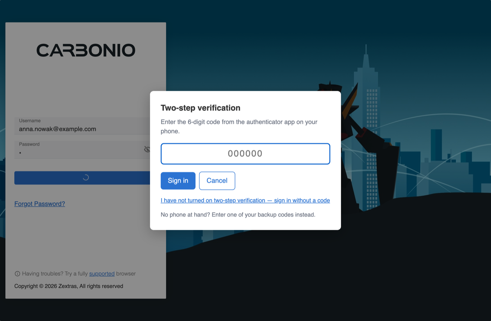 | 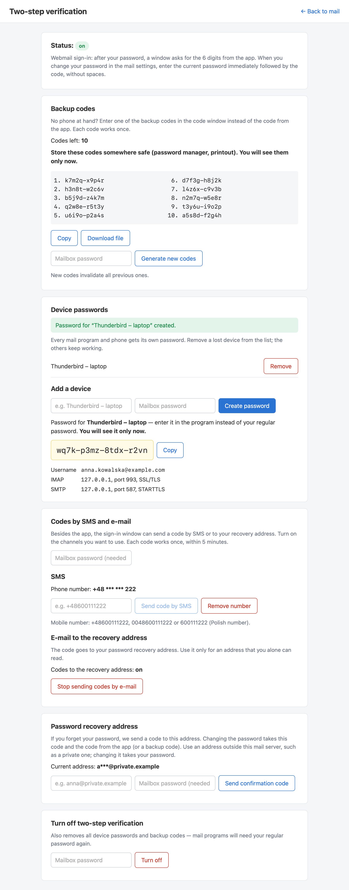 | 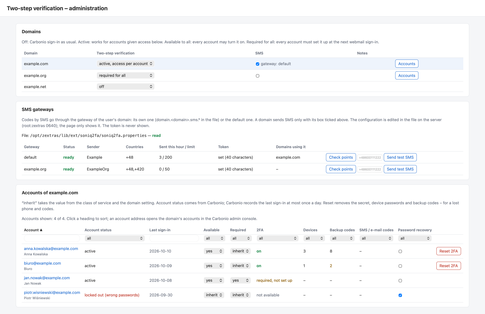 |


## User guide

Something to hand to users once 2FA is available to them. The examples use the fictitious user
`anna.kowalska@example.com` on `mail.example.com`; replace them with your own.

### 1. Install an authenticator app

On your phone: Google Authenticator, Microsoft Authenticator, Authy, 1Password or Bitwarden.

### 2. Open the page

Sign in to webmail and open **Settings → Two-step verification** (or
`https://mail.example.com/service/extension/soniq2fa`). The page explains what changes and that turning 2FA on
also turns off password recovery by mail, which would let a mailed code skip the second factor.

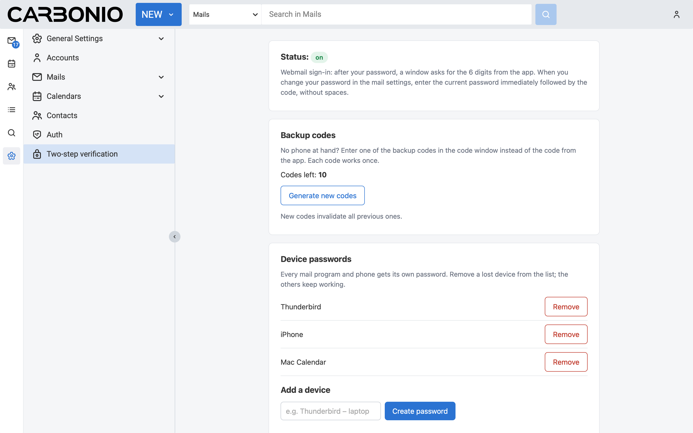

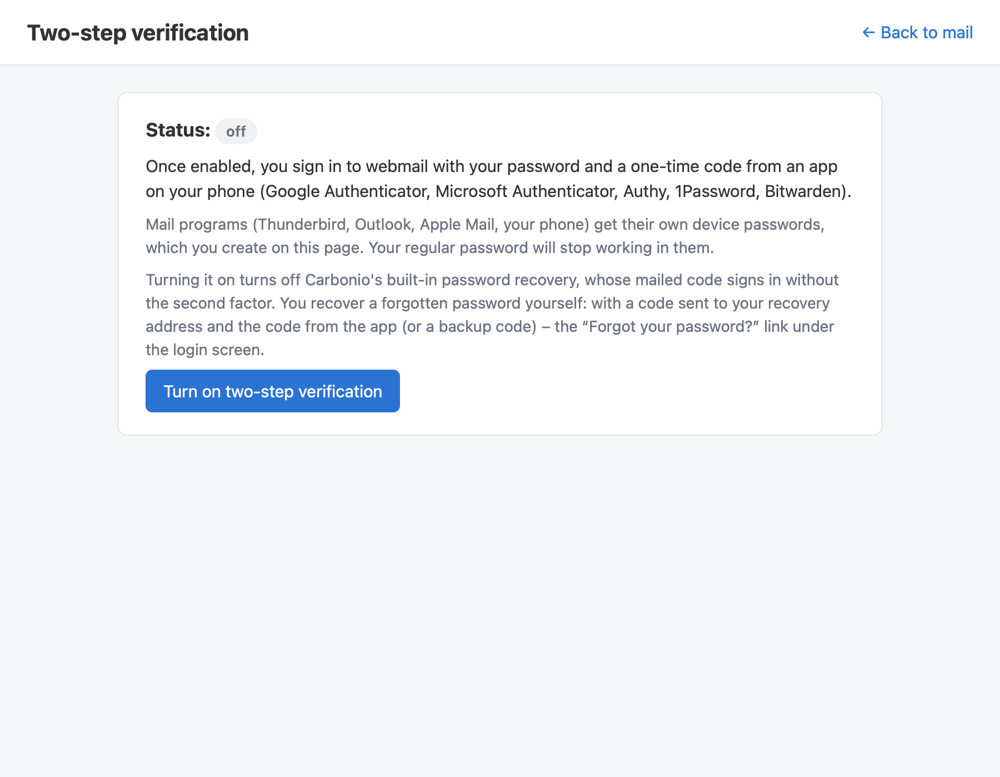

### 3. Scan the QR code and confirm

Click **Turn on two-step verification**. Scan the QR code with the app (or type the key shown next to it), then
enter your mailbox password and the 6-digit code the app shows, and click **Confirm and turn on**. A badly scanned
code changes nothing: 2FA is on only after the first correct code.

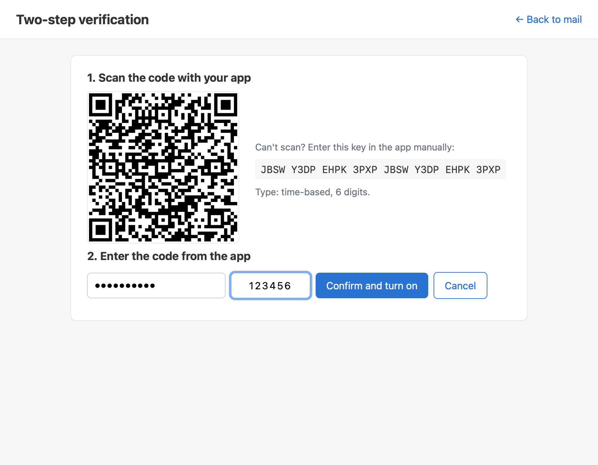

### 4. Save the backup codes

The page shows 10 single-use backup codes once. Download or copy them and keep them away from the phone (a password
manager, a printout). They replace the phone when it is not at hand. **Generate new codes** asks for your password and
voids the old ones.

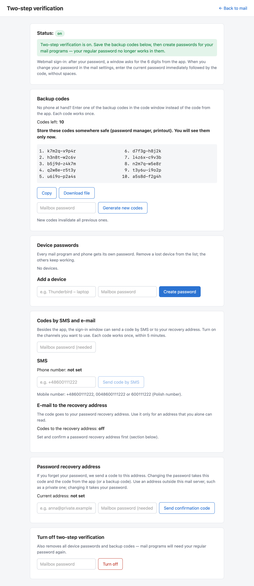

### 5. Create a device password for every mail program

From now on Thunderbird, Outlook, Apple Mail, mail, calendar and contacts on the phone, and the calendar and contacts
accounts in macOS no longer accept your regular password. Under **Device passwords** type a name (for example
*Thunderbird – laptop*) and your mailbox password, click **Create password** and enter the password shown in that
program instead of your regular one. It is shown only once; a lost device is removed from the list without touching
the others.


### 6. Set a password recovery address

Under **Password recovery address** enter an address outside this mailbox (a private one), click **Send confirmation
code** and enter the code from that e-mail. If you forget your password, recovery sends a code there.

### 7. Codes by SMS or e-mail (optional)

Under **Codes by SMS and e-mail**: enter your mailbox password and your mobile number (`+48600111222`,
`0048600111222` or, for a Polish number, `600111222`), click **Send code by SMS** and
confirm the number with the code from the message; or, with a confirmed recovery address outside this mail server, enter
the password and click **Send codes to the recovery address**. The sign-in window then
offers **Send the code by SMS** / **Send the code by e-mail**. Each code works once, within 5 minutes. Use the e-mail
option only for an address that you alone read.

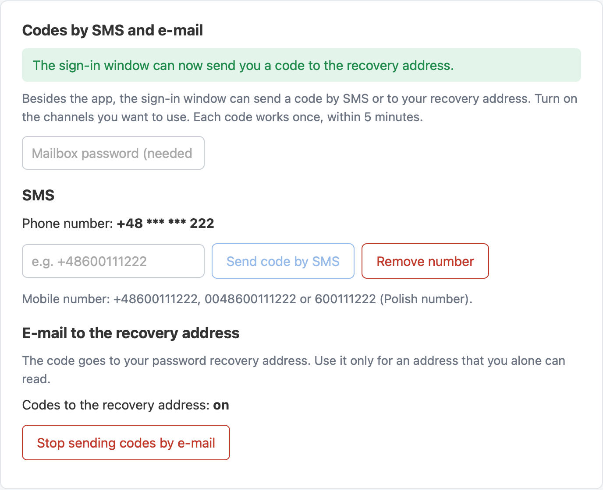

### 8. Signing in to webmail

Enter your address and password as before. A window asks for the 6-digit code from the app; instead of the code
you can enter one of the backup codes. In a browser that has not seen you sign in with a code yet, the window
appears once the server has accepted the password; a wrong password gets the usual error, a wrong code asks again:

| Browser you used before | New browser, after the password alone |
|---|---|
|  | 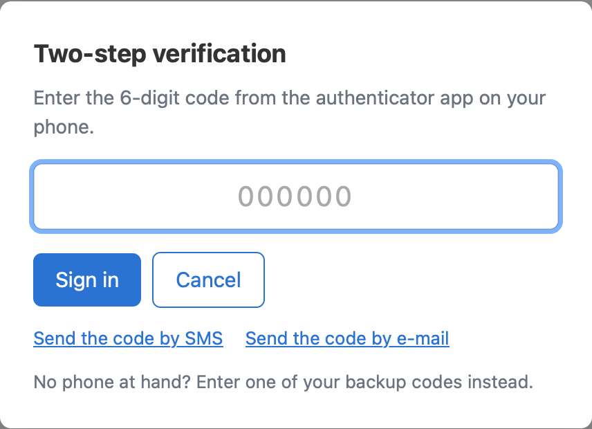 |

### When 2FA is required

If your administrator requires 2FA, the page opens over webmail at the next sign-in. Set it up as in steps 3–5;
**Continue to mail** unlocks once 2FA is on. A required account cannot turn 2FA off; after changing phones use
**Set up again**, which replaces the app entry and the backup codes and keeps the device passwords.

| First sign-in | Settings of a required account |
|---|---|
| 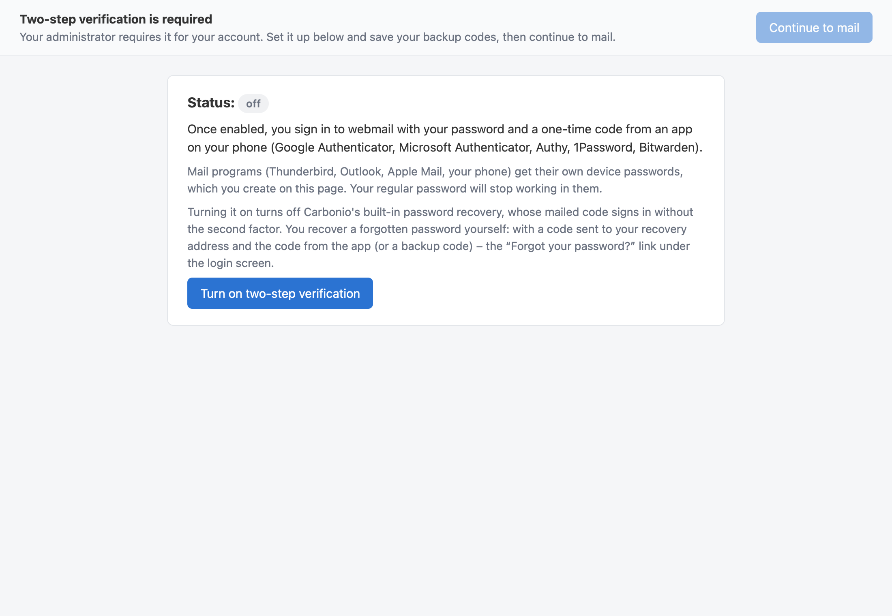 | 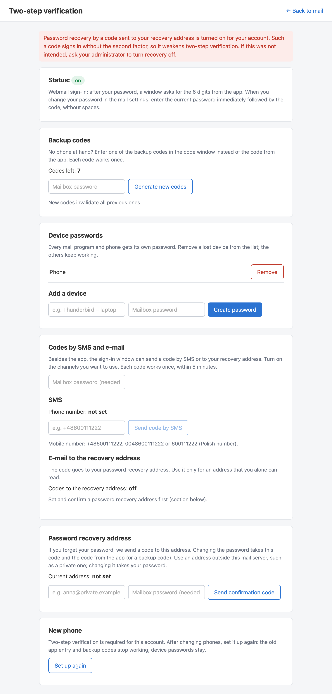 |

The red note at the top appears when password recovery by mail is turned on for your account: it weakens 2FA,
ask your administrator to turn it off unless it was intended.

### When something goes wrong

- *Auth credentials have expired* on the login page: reload the page and sign in again.
- A mail program keeps asking for the password: it needs a device password, not the mailbox password.
- Lost phone: sign in with a backup code, turn 2FA off and on again with the new phone (where 2FA is required:
  *Set up again*). Remove device passwords of lost devices from the list. Lost phone and backup codes: ask the
  administrator to reset 2FA.
- Forgotten password: **Forgot your password?** under the login screen
  (`https://mail.example.com/service/extension/soniq2fa-recover`). Enter your address; a code goes to your recovery
  address. Then enter that code, the code from the app (or a backup code) and a new password. Without a recovery
  address, the administrator sets a new password; 2FA stays on.
- Changing the password in the mail settings: enter the current password immediately followed by the code,
  without spaces.

| Step 1 | Step 2 |
|---|---|
| 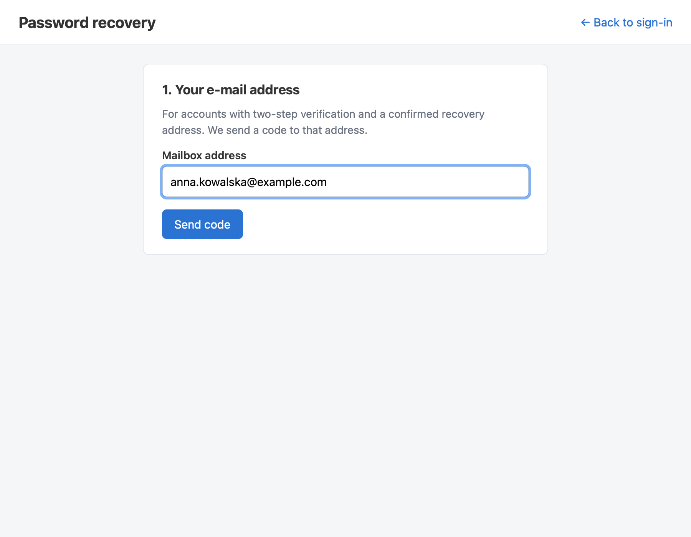 | 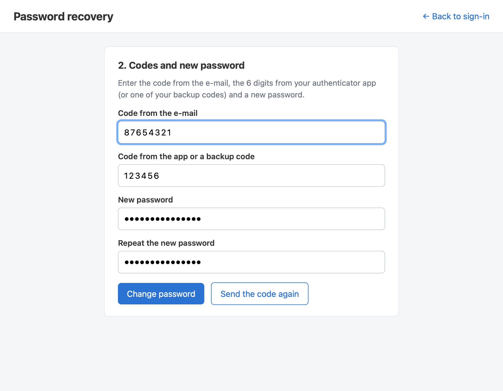 |

## Security model

- Every path needs something beyond the mailbox password, and a device password never opens a webmail session.
- Turning 2FA on ends every webmail and admin console session of the account opened so far, possibly with the
  password alone, the way a password change does (`zimbraAuthTokenValidityValue` + 1); the session that turns it on
  gets a new cookie and continues.
- IMAP checks credentials only at login. Turning 2FA on, revoking a device password, an admin reset and a password
  recovery therefore close the account's open IMAP connections; mail clients with a valid device password reconnect
  by themselves, a client still holding the mailbox password is refused at its next login.
- For webmail the mailbox password is checked first, then the code. Wrong codes at sign-in, and the password and
  first code when turning 2FA on, share one limit: 5 attempts per account per 10 minutes.
- Refusals reach the client as a generic "authentication failed", with one deliberate exception for SOAP (webmail,
  admin console): the right password without a code, or with a wrong one, is answered `TWO_FACTOR_AUTH_REQUIRED` /
  `TWO_FACTOR_AUTH_FAILED`, so the login page asks for the code only after the right password. Password guessing
  stays limited by the Carbonio lockout policy, which counts these answers as failed logins. The reason for every
  refusal is written to the mailbox log.
- SMTP AUTH reaches the mailbox as SOAP from `saslauthd`. It is recognised by the local port of the connection
  (`zimbraMtaAuthPort`, 7073 by default, not proxied by nginx), by the peer address (loopback, a local address
  or a server running the `mta` service) and by not being an admin login. Headers such as `X-Forwarded-Proto`
  are not trusted: on the HTTPS virtual host nginx passes them from the client.
- A TOTP code is accepted only from a time step later than the last accepted one for the account. Wrong second
  factors are limited to 5 per 10 minutes and 50 a day per account.
- POSTs with a query string are refused. Jetty prefers query parameters over the body, so otherwise a crafted link
  could change what a page sends when the user clicks something.
- Password recovery only uses an address confirmed with a mailed code on the self-service page. The address itself
  is a user preference that any session can change through `ModifyPrefs`, so the page also stores the confirmed one in
  `zimbraTwoFactorAuthTrustedDevices` (`recovery:<address>`), which users can't write. Changing it needs the mailbox
  password and an address outside this server. The old address gets a notice, and so does the recovery address when
  2FA is turned on.
- Codes by SMS and e-mail are channels the user turns on, with the mailbox password typed again (a stolen session
  alone cannot bind another phone); the phone number is confirmed with an SMS code, the address is the confirmed
  recovery address and must be outside the domains of this server (otherwise a device password could read the code).
  The login page asks for a code only together with the mailbox password, and the server sends it only when that
  password is right, so strangers cannot run up SMS costs. That check follows the Carbonio lockout policy, has its own
  limit per account and client, and the answer is the same either way, so the endpoint reveals neither the password
  nor the channels.
  A sent code has 6 digits, works once within 5 minutes and counts against the same attempt limit as app codes.
  These channels are weaker than the app (SIM swap, a shared private mailbox); the e-mail channel turns the
  recovery address into a second factor, so the page says to use it only for an address the user alone reads.
- Creating a device password, getting new backup codes and turning 2FA off also ask for the mailbox password.
  Someone who finds a webmail session left open can't use it to weaken the account's 2FA.
- Device passwords (~99 bits) and backup codes (~49 bits) are random and stored as salted SHA-256.
  The TOTP secret in `zimbraTwoFactorAuthSecret` is encrypted (AES-256-GCM, bound to the account id) with a key kept
  outside LDAP in `/opt/zextras/lib/ext/soniq2fa/totp.key`, so LDAP dumps and backups alone don't give it away.
  Back the key up together with the server: without it, encrypted secrets can't be read and those users can't sign in
  until an admin resets their 2FA.
- The self-service page validates the session like the rest of Carbonio (expiry, logout, password change,
  account status), requires a custom request header and a same-host `Origin`, sends a strict
  Content-Security-Policy and refuses delegated ("log in as") sessions, except an admin's own mailbox opened from the
  admin console (a session the admin delegates to itself).

### Configuration the extension relies on

The self-service page refuses to turn 2FA on, and says why, when any of these would let a login skip the
second factor:

| Setting | Required | Why |
|---|---|---|
| `zimbraAuthFallbackToLocal` (domain, inherited from global) | `FALSE` | when `TRUE`, the mailbox retries a refused login with the plain password |
| `zimbraAuthMechAdmin` (domain) | unset or `custom:soniq2fa` | admin-console logins use this mechanism instead |
| `zimbraFeatureResetPasswordStatus` (account/COS) | not `enabled` | password recovery signs in with a mailed code, outside the domain mechanism; turning 2FA on sets it to `disabled` on the account, and a login of an enrolled account with it `enabled` is logged as an error |

Also recommended:

- Port 7073 reachable only from the MTA (firewall, or `zimbraMtaAuthBindAddress`).
- `zimbraPasswordLockoutEnabled TRUE`, so password guessing is limited too.

## Requirements

- Carbonio CE, **single-server installation**. On several mailbox servers the replay guard, the attempt limit
  and account caches are per server, which weakens both; not supported yet.
- Java 17 to build (the jar runs on the Java 17 or 21 of the mailbox).

| `carbonio-mailbox-jar` | Jetty | Status |
|---|---|---|
| 4.24 – 4.27 | 9.4 | tested on 4.25.2 (Carbonio CE 26.3) |
| 4.28 and later | 12 (ee8) | API checked against the source, not tested on a server |
| 4.20 – 4.23 | 9.4, Java 17 | not tested |

At start-up the extension logs an error if it does not recognise the Jetty version. SMTP AUTH of enrolled
users is then refused (the failure is closed, not open).

## Build

The Carbonio jars are not part of this repository. Copy them from a Carbonio host
(`/opt/zextras/mailbox/jars/`): `mailbox.jar`, `zm-common-*.jar`, `zm-client-*.jar`,
`mailbox-attribute-manager-*.jar`, `mail-*.jar` (JavaMail), `httpclient-4*.jar` and
`httpcore-4*.jar` (compile time only, for the session cookie API) and the servlet API jar
(`javax.servlet-api-*.jar`, or `jetty-servlet-api-*.jar` on 4.28+). Jetty itself is used through reflection.

```bash
./build.sh /path/to/carbonio/jars
```

The script compiles, packs `build/soniq2fa.jar` and runs the self-test (RFC 6238 vectors, device passwords,
backup codes, replay and rate limits).

The web parts (self-service page, Settings module, login page script, administration page) have browser tests in
WebKit against a local stand-in for the extension API with fictitious data; `--shots` also renders the screenshots
in `docs/`:

```bash
npm i playwright && npx playwright install webkit
node test/ui-test.cjs [--shots]
```

## Install

The steps, in order (each one is described below):

1. **Build the jar** against the jars of this server ([Build](#build)).
2. **Install the jar** and restart the mailbox (below).
3. **Enable it for a domain** with `zimbraAuthMech` and `zimbraAuthFallbackToLocal FALSE` (below), then choose who may
   or must use it ([Who can turn it on, who must](#who-can-turn-it-on-who-must)).
4. **Add the code dialog** to both login pages and the **2FA** button to the admin console, with the apt hook that keeps
   them after upgrades ([Login page dialog](#login-page-dialog)). Without this step, users type the password
   immediately followed by the code into the password field.
5. **Add the Settings entry** to webmail ([Webmail Settings entry](#webmail-settings-entry)).
6. Optional: **monitoring** ([Monitoring (Zabbix)](#monitoring-zabbix)) and **codes by SMS**
   ([Codes by SMS and e-mail](#codes-by-sms-and-e-mail)); codes by e-mail need no configuration.
7. **Hand the user guide to users** ([User guide](#user-guide); Polish: *Instrukcja dla użytkownika*).

After every Carbonio upgrade go through [After a Carbonio upgrade](#after-a-carbonio-upgrade).

On the Carbonio server, as root:

```bash
install -d -m 755 /opt/zextras/lib/ext/soniq2fa
install -m 644 build/soniq2fa.jar /opt/zextras/lib/ext/soniq2fa/
systemctl restart carbonio-appserver
grep "Initialized extension soniq2fa" /opt/zextras/log/mailbox.log
```

Then enable it per domain, as the `zextras` user:

```bash
carbonio prov md example.com zimbraAuthFallbackToLocal FALSE
carbonio prov md example.com zimbraAuthMech custom:soniq2fa
```

> **`zimbraAuthFallbackToLocal` must be `FALSE`.** When it is `TRUE` (the global default on many
> installations), the mailbox retries a refused login with the plain password, and the second factor
> can be bypassed. See [Configuration the extension relies on](#configuration-the-extension-relies-on).

Users find the page in webmail Settings (see [Webmail Settings entry](#webmail-settings-entry)) or at its address.

### Who can turn it on, who must

The mechanism alone changes nothing for users: an account turns 2FA on only when it is offered, and accounts
without 2FA sign in as before. Offering and requiring are set per domain (an argument of the mechanism) or per
account and class of service, with the attributes Carbonio inherited from Zimbra:

| Setting | Effect |
|---|---|
| `zimbraAuthMech "custom:soniq2fa"` | extension active, 2FA offered only to accounts with one of the attributes below |
| `zimbraAuthMech "custom:soniq2fa available"` | every account of the domain may turn 2FA on |
| `zimbraAuthMech "custom:soniq2fa required"` | every account of the domain must |
| `zimbraFeatureTwoFactorAuthAvailable TRUE` (account or COS) | this account may turn 2FA on |
| `zimbraFeatureTwoFactorAuthRequired TRUE` (account or COS) | this account must |

```bash
carbonio prov ma user@example.com zimbraFeatureTwoFactorAuthAvailable TRUE   # offer to one account
carbonio prov ma user@example.com zimbraFeatureTwoFactorAuthRequired TRUE    # require from one account
carbonio prov md example.com zimbraAuthMech "custom:soniq2fa required"       # require from the whole domain
```

Only accounts with 2FA offered see the Settings entry. Where 2FA is required and not set up yet, the first webmail
session opens the self-service page over the whole window, and webmail becomes usable once 2FA is on and the
backup codes are shown. A required account cannot turn 2FA off; after changing phones it sets 2FA up again, which
replaces the secret and the backup codes and keeps the device passwords.

The server enforces the requirement too. A required account that hasn't set 2FA up gets a grace period, 7 days by
default from its first sign-in after the requirement, in which the password alone still works everywhere (so mail
programs keep working while the user moves them to device passwords). After that the password alone is refused in
webmail, the admin console and mail programs. The login page then links to a setup page
(`/service/extension/soniq2fa-recover?op=enroll`) where the user enters the address and password, scans the QR code,
confirms it with the first code and gets the backup codes. The period is set with `required.graceDays=7` (0 turns it
off) in the gateway file, `/opt/zextras/lib/ext/soniq2fa/soniq2fa.properties`. The start of the period is kept in
`zimbraTwoFactorAuthTrustedDevices` as `required-since:<ms>`; an admin reset starts it again.

### Login page dialog

The Carbonio CE login page has no step for a second factor without the commercial `/zx/auth` service. soniq2fa
adds one without modifying the page itself: a small script (`install/login.js`, installed as
`/static/login/soniq2fa-login.js`), loaded by the login page before its own bundle, wraps `fetch`. When the form
sends `AuthRequest` (or `ChangePasswordRequest`) for a domain that uses `custom:soniq2fa`, the script asks for the code in a dialog
and appends it to the password. The dialog opens before the request when this browser remembers the user as enrolled (the self-service page and every sign-in with
a code store a hint in the browser), and otherwise only when the server answers `TWO_FACTOR_AUTH_REQUIRED`: the
handler answers a wrong password with `AUTH_FAILED`, the right password without a code with
`TWO_FACTOR_AUTH_REQUIRED` and with a wrong code with `TWO_FACTOR_AUTH_FAILED`. Users without 2FA, and anyone with a
wrong password, never see the dialog. This tells a caller whether the password is right before the second factor;
the Carbonio lockout policy (keep `zimbraPasswordLockoutEnabled TRUE`) counts all three answers as failed logins, and
mail protocols still take device passwords only. On a new device the first attempt without the code counts as one
failed login. Other domains log in exactly as before. If the extension is missing, the domain check fails and the
page logs in as usual. Being a plain file, the script is updated without restarting the mailbox.

The script also fixes two problems of the CE login page that 2FA makes frequent, for every account:

- a browser that still holds an invalidated session cookie (after a password change, or turning 2FA on or off) is
  refused before the password is checked ("auth credentials have expired"); the script clears the cookie through
  Carbonio's own `/logout` and sends the login once more;
- after the code dialog the connection may have been closed by the server while idle, and Safari fails the POST
  with "Load failed"; the script opens a fresh connection first and retries once on a network error.

The page learns whether a domain uses soniq2fa from `?op=domain&name=<domain>`; it reveals nothing about accounts.

Add the script tag (idempotent) and keep it after package upgrades, which replace `index.html`:

```bash
install -m 755 install/login-inject.sh /opt/zextras/lib/ext/soniq2fa/
install -m 644 install/login.js install/admin-link.js /opt/zextras/lib/ext/soniq2fa/
/opt/zextras/lib/ext/soniq2fa/login-inject.sh
echo 'DPkg::Post-Invoke { "/opt/zextras/lib/ext/soniq2fa/login-inject.sh || true"; };' \
  > /etc/apt/apt.conf.d/99soniq2fa-login
```

The same script adds the dialog to the admin console login page (`/opt/zextras/admin/login/index.html`, without the
password recovery link) and puts a small **2FA** button into the admin console (bottom right, `admin-link.js` installed as
`/static/iris/soniq2fa-admin-link.js` and loaded by the console's `index.html`), leading to the administration page.

To take it out: `/opt/zextras/lib/ext/soniq2fa/login-inject.sh remove` and delete the apt hook.

### Webmail Settings entry

`install/settings/` is a small Carbonio web module that adds *Two-step verification* to webmail Settings and shows
the self-service page there. The entry appears only for accounts with 2FA offered or already on, and the module
also opens the page over webmail where 2FA is required and not set up yet.

```bash
cd install && ./settings.sh          # ./settings.sh remove to take it out
```

The script copies the module to `/opt/zextras/web/iris/soniq2fa-ui/` and rebuilds `components.json` the same way
the Carbonio web packages do on every installation, so the entry stays after upgrades. Users reload webmail to see it.

### Monitoring (Zabbix)

`install/zabbix/` has an agent check and its UserParameters:

```bash
install -m 755 install/zabbix/soniq2fa-check.sh /opt/zextras/lib/ext/soniq2fa/
install -m 644 install/zabbix/soniq2fa.conf /etc/zabbix/zabbix_agent2.d/
zabbix_agent2 -R userparameter_reload
```

- `soniq2fa.ext[<public host name>]` — 1 the extension answers, 0 the mailbox is up but the extension is missing
  (users of soniq2fa domains cannot sign in), -1 the mailbox does not answer. Use a numeric (float) item and alert
  on three zeros in a row.
- `soniq2fa.login` — 1 all three pages carry their script (webmail login, admin console login, admin console button),
  0 a tag disappeared from an `index.html` (a package upgrade replaced it and the apt hook did not run).
- `soniq2fa.sms` — 1 the SMS gateway file is readable by the mailbox, 0 it exists but is unreadable (SMS is hidden for
  everyone), 2 SMS is not configured.
- `soniq2fa.key` — 1 the TOTP secret key is readable by the mailbox, 0 it exists but is unreadable (users with
  encrypted secrets can't sign in), 2 there is no key (new secrets are stored in plain text, and
  already encrypted ones can't be read).

## Administration

### Administration page

`https://mail.example.com:6071/service/extension/soniq2fa-admin`. Open it on the admin console port after signing
in to the admin console; it uses that session and is limited to global admins. Carbonio CE's admin console loads no
external modules, so the page stands on its own; the console only gets a **2FA** button in the bottom right corner
that opens it (see *Login page dialog*). It shows:

- every domain with its level (off, active with access per account, available to all, required for all) and warnings
  about `zimbraAuthFallbackToLocal` and `zimbraAuthMechAdmin`; any level but *off* also sets
  `zimbraAuthFallbackToLocal FALSE`;
- the accounts of a domain: *Available* and *Required* (inherit / yes / no), state, number of device passwords,
  backup codes left, and password recovery;
- *Reset 2FA* for a user who lost both the phone and the backup codes.


Typical tasks:

- **Offer 2FA to a few people first.** Set the domain to *active, access per account*, open *Accounts* and set
  *Available* to *yes* for them. Nobody else sees anything.
- **Offer it to everyone.** Set the domain to *available to all*.
- **Require it.** *Required: yes* for an account, or *required for all* for the domain. Each affected user gets the
  setup window at the next webmail sign-in. During the grace period mail programs keep working with the password;
  after it the password alone is refused.
- **A user lost the phone and the backup codes.** *Reset 2FA*, then the user sets it up again and creates new
  device passwords.
- **A user forgot the password.** Users with a confirmed recovery address do it themselves (mailed code plus the code
  from the app, see the user guide). Otherwise set a new one in the admin console or with `carbonio prov sp`; 2FA
  stays on.

### Password recovery

`/service/extension/soniq2fa-recover`, linked from the login page, lets an account with 2FA and a confirmed recovery
address (`zimbraPrefPasswordRecoveryAddress`, the attribute Carbonio uses, set on the self-service page with a mailed
confirmation code) set a new password with a code mailed to that address **and** the code from the app or a backup
code. The answer to the first step is the same for every account and the mail is sent in the background, so the page
does not tell who has 2FA. A mailed code is valid for 15 minutes and 5 tries, an account gets at most one mail a
minute and 5 an hour, and the second factor is rate-limited as at sign-in. The new password follows the
Carbonio password policy, a lockout is lifted, and a notice goes to the recovery address. Every step is logged with the client address.

Turning 2FA on turns Carbonio's own password recovery off for the account. Turning it back on from the administration
page for an account with 2FA asks first, because a mailed recovery code signs in without the second factor; the user
then sees a warning on the self-service page, and every login of that account is logged as an error. Every change made
on the administration page is logged in `mailbox.log` with the admin's name.

### Codes by SMS and e-mail

Users can have the code dialog of the login page send a code by SMS or to their confirmed recovery address, instead of
reading it from the app. Both are turned on per user on the self-service page and are stored in
`zimbraTwoFactorAuthTrustedDevices` (multi-valued, unused by Carbonio CE, immutable in the schema so users cannot set
it through SOAP): `sms:+48600111222` for a number confirmed with an SMS code, `email` for codes to the recovery address.
*Reset 2FA* and turning 2FA off clear them.

E-mail codes work without configuration. SMS needs a gateway and is turned on **per domain**: tick *SMS* for the
domain on the administration page (it adds the flag `sms` to the domain's mechanism, e.g.
`custom:soniq2fa available sms`). Domains without the flag never send SMS, so no domain sends them on a gateway it was
not meant to use. The extension speaks the [SMSAPI](https://www.smsapi.pl/docs) REST API. Create an OAuth token in the
SMSAPI panel (scope *sms*) and, as root, write `/opt/zextras/lib/ext/soniq2fa/soniq2fa.properties`:

```properties
sms.provider=smsapi
sms.token=<token>
# sender name registered in SMSAPI; empty: the account's default
sms.from=
# optional
#sms.url=https://api.smsapi.pl/sms.do
#sms.maxPerHour=200
```

```bash
chown root:zextras /opt/zextras/lib/ext/soniq2fa/soniq2fa.properties
chmod 640 /opt/zextras/lib/ext/soniq2fa/soniq2fa.properties
```

Editing the file with `sed -i` or an editor that writes a new file resets the group to `root`; the mailbox then cannot
read it, SMS disappears and `mailbox.log` says so (`cannot read it`). Run the `chown` again after such an edit.

Numbers are accepted only with the prefixes in `sms.countries` (default `+48`; e.g. `sms.countries=+48,+420`), against
SMS pumping to premium or foreign numbers. Those keys make the **default gateway**. A domain can have its own
gateway (another SMSAPI account, sender or limit) by overriding any key as `domain.<domain>.sms.<key>`; with its own `sms.token` it is a separate gateway with its own
hourly limit, otherwise it uses the default one with the overridden values:

```properties
# example.org pays for its own SMS
domain.example.org.sms.token=<token of example.org>
domain.example.org.sms.from=ExampleOrg
# example.net uses the default gateway with another sender
domain.example.net.sms.from=ExampleNet
```

#### Other SMS gateways (any HTTP API)

Instead of SMSAPI a gateway can be any service that sends an SMS with one HTTP request. Set `sms.provider=http` and
describe the request; `{to}` (`+48600111222`), `{to_digits}` (`48600111222`), `{text}` and `{from}` are replaced in the
address (URL-encoded) and in the body (encoded as `sms.http.encoding` says: `form`, `json` or `none`):

| Key | Meaning |
|---|---|
| `sms.http.url` | address of the send call |
| `sms.http.method` | `POST` (default) or `GET` |
| `sms.http.header.<Name>` | a request header, e.g. `Authorization`, `Content-Type` (values are never shown on the page) |
| `sms.http.body` | body template |
| `sms.http.encoding` | `form` (default), `json`, `none` |
| `sms.http.success.status` | accepted HTTP codes, default `200,201,202` |
| `sms.http.success.match` | optional regular expression that must be found in the answer |
| `sms.http.balance.url`, `sms.http.balance.match` | optional: balance for the administration page (group 1 of the expression) |

Twilio ([Messages API](https://www.twilio.com/docs/messaging/api/message-resource#create-a-message-resource);
`Authorization` is `Basic` with base64 of `AccountSID:AuthToken`):

```properties
sms.provider=http
sms.from=+15005550006
sms.http.url=https://api.twilio.com/2010-04-01/Accounts/<AccountSID>/Messages.json
sms.http.header.Authorization=Basic <base64 of AccountSID:AuthToken>
sms.http.header.Content-Type=application/x-www-form-urlencoded
sms.http.body=To={to}&From={from}&Body={text}
sms.http.success.status=201
sms.http.success.match="status"\s*:\s*"(queued|accepted|sending|sent)"
```

Vonage SMS API (`https://rest.nexmo.com/sms/json`, basic auth with API key and secret; a sent message has status `"0"`):

```properties
sms.provider=http
sms.from=Example
sms.http.url=https://rest.nexmo.com/sms/json
sms.http.header.Authorization=Basic <base64 of key:secret>
sms.http.header.Content-Type=application/x-www-form-urlencoded
sms.http.body=from={from}&to={to_digits}&text={text}
sms.http.success.match="status"\s*:\s*"0"
```

A gateway with a JSON API and a bearer token (fictitious service):

```properties
sms.provider=http
sms.http.url=https://api.example.com/v1/sms
sms.http.header.Authorization=Bearer <token>
sms.http.header.Content-Type=application/json
sms.http.encoding=json
sms.http.body={"to":"{to}","sender":"{from}","message":"{text}"}
sms.http.success.match="ok"\s*:\s*true
sms.http.balance.url=https://api.example.com/v1/balance
sms.http.balance.match="balance"\s*:\s*([0-9.]+)
```

Check every new gateway with **Send test SMS** on the administration page before ticking SMS for a domain; a refusal
is shown there and logged in `mailbox.log` (the answer without phone numbers). The same keys work per domain
(`domain.<domain>.sms.provider=http`, …), so domains can use different providers. Gateways that do not speak HTTP
(SMPP, GSM modems) need an HTTP bridge in front of them.

The administration page shows every gateway read-only (state, sender, countries, messages this hour against the
limit, whether the token is set but never the token, the domains using it) and can check the SMSAPI points and send
a test SMS. The file is read at every send, so changes need no restart; without it the SMS option stays hidden. An
account gets at most one login code a minute and five an hour, and as many phone confirmations; each gateway sends at
most its own `sms.maxPerHour` SMS an hour. Every send, and every refusal of the gateway with its answer, is logged in
`mailbox.log` (`soniq2fa: login code`, `soniq2fa: SMS`).

### Command line

The 2FA attributes are marked immutable in the Carbonio schema, so `carbonio prov` refuses to change
them. To reset a user who lost both the phone and the backup codes without the page, remove the attributes in LDAP:

```bash
# as zextras
ldapmodify -x -H "$(zmlocalconfig -m nokey ldap_master_url | cut -d' ' -f1)" \
  -D "$(zmlocalconfig -m nokey zimbra_ldap_userdn)" \
  -y <(zmlocalconfig -s -m nokey zimbra_ldap_password | tr -d '\n') <<EOF
dn: uid=user,ou=people,dc=example,dc=com
changetype: modify
delete: zimbraTwoFactorAuthSecret
-
delete: zimbraTwoFactorAuthScratchCodes
-
delete: zimbraAppSpecificPassword
EOF
carbonio prov fc -a account user@example.com
```

Log lines are written to `mailbox.log` with the prefix `soniq2fa:`: enabled, disabled, device password
created/revoked/accepted, backup code used, and every refusal with its reason. `audit.log` records the refused
login as usual.

To turn the extension off for a domain: `carbonio prov md example.com zimbraAuthMech ""`. Enrolled users keep
their settings and get them back if it is turned on again.

To remove it, run `login-inject.sh remove`, delete the apt hook and clear `zimbraAuthMech` on **every** domain that
uses it (a domain still pointing to `custom:soniq2fa` after the extension is gone lets nobody sign in). Then delete
`/opt/zextras/lib/ext/soniq2fa` and restart the mailbox. Keep a copy of `totp.key` if you may install it again.

## Upgrading soniq2fa

Coming from 1.0.0, create the key that encrypts TOTP secrets, once, as root:

```bash
(umask 077; head -c 32 /dev/urandom | base64 -w0 > /opt/zextras/lib/ext/soniq2fa/totp.key)
chown root:zextras /opt/zextras/lib/ext/soniq2fa/totp.key && chmod 640 /opt/zextras/lib/ext/soniq2fa/totp.key
```

New secrets are then stored encrypted. Existing ones keep working as they are; to encrypt them too, replace each value
with the output of `java -cp soniq2fa.jar pl.soniqsoft.soniq2fa.TwoFa seal <key file> <zimbraId> -` (secret on standard
input) through LDAP. Add the key to your backups.

Recovery addresses confirmed with 1.0.0 have to be confirmed once more on the self-service page. Until
then password recovery and codes by e-mail are off for those accounts. If you'd rather not ask users, check the
addresses and add `recovery:<address in lower case>` to `zimbraTwoFactorAuthTrustedDevices` of each account (it is
immutable, so through LDAP, as in *Command line*).

## After a Carbonio upgrade

Rebuild the jar against the new mailbox jars, reinstall, and check `Initialized extension soniq2fa` in
`mailbox.log`. If the extension fails to load, users of a domain with `custom:soniq2fa` cannot sign in
at all: the failure is closed, not open. Check also that no "unknown Jetty version" error follows; without it,
SMTP AUTH of enrolled users is refused.

Packages that replace files the extension touches, and what restores them:

| Package | File | Restored by |
|---|---|---|
| `carbonio-login-ui` | `/opt/zextras/web/login/index.html` (code dialog) | apt hook `99soniq2fa-login` |
| `carbonio-admin-login-ui` (admin console login) | `/opt/zextras/admin/login/index.html` (code dialog) | the same hook |
| `carbonio-admin-console-ui` | `/opt/zextras/admin/iris/carbonio-admin-ui/current/index.html` (**2FA** button) | the same hook |
| web `carbonio-*-ui` packages | `/opt/zextras/web/iris/components.json` (Settings entry) | the packages rebuild it from every `component.json`, ours included; `settings.sh` if the entry is gone |
| `carbonio-mailbox-jar` | the mailbox jars the extension is built against | rebuild and reinstall the jar |

After an upgrade: `soniq2fa.login` and `soniq2fa.ext` must be 1, the Settings entry must be visible in webmail, and the
code dialog must appear on both login pages after the right password. Run `login-inject.sh` by hand if the hook did not.

The login pages send the same `AuthRequest` JSON; a change in how the server answers a login (error codes) shows on
**both**, so test the admin console login too.

## Limitations

- The login dialog relies on the CE login forms calling `/service/soap/AuthRequest` (webmail) and
  `/service/admin/soap/AuthRequest` (admin console) through `fetch` (carbonio-login-ui 0.9.x–0.11.x and the matching
  carbonio-admin-login-ui).
- During the grace period of a required account (see *Who can turn it on, who must*) the password alone still works,
  and whoever knows it can set 2FA up with their own phone first. Keep the period short where it matters and ask
  users to set it up soon.
- Carbonio's built-in password recovery and 2FA exclude each other (its mailed code skips the second factor); the
  extension's own recovery replaces it for enrolled accounts. Its codes are kept in memory, so a mailbox restart voids
  them, and mail goes out through the local MTA with the account itself as the sender.
- Codes by SMS and e-mail complement the app: an account turns them on after setting up 2FA with the app, and 2FA by
  SMS alone is not offered. SMS goes through SMSAPI or any gateway with an HTTP API. Pending codes are kept in memory,
  so a mailbox restart voids them.
- REST access with HTTP basic auth is not available to enrolled users.
- Single-server installations only (see Requirements).

## Translations

Texts of the self-service page are in `src/pl/soniqsoft/soniq2fa/i18n/<language>.json`. The page uses the
language set in Carbonio (`zimbraPrefLocale`), then the browser's, then English; missing keys fall back to
English. To add a language, copy `en.json`, translate the values and rebuild. Available: English, Polish.

## License

Copyright © 2026 SoniqSoft sp. z o.o.

This program is free software; you can redistribute it and/or modify it under the terms of the GNU General Public
License as published by the Free Software Foundation; either version 2 of the License, or (at your option) any later
version (SPDX: `GPL-2.0-or-later`); see [LICENSE](LICENSE). "Or later" keeps it compatible both with the Carbonio CE
mailbox (GPL-2.0-only) and with the Carbonio web interface (AGPL-3.0-only), in whose pages the browser parts run.

The bundled QR code generator is MIT-licensed. Build-time dependencies, the Carbonio web interface and the screenshots
that show it (© Zextras S.r.l.) are described in [THIRD-PARTY-NOTICES](THIRD-PARTY-NOTICES).

This program is distributed in the hope that it will be useful, but WITHOUT ANY WARRANTY; without even the
implied warranty of MERCHANTABILITY or FITNESS FOR A PARTICULAR PURPOSE.

soniq2fa is an independent project, not affiliated with or endorsed by Zextras S.r.l. or Synacor, Inc.
Carbonio and Zextras are trademarks of Zextras S.r.l.; Zimbra is a trademark of Synacor, Inc.

---

## Po polsku

Rozszerzenie dodaje do **Carbonio CE** weryfikację dwuetapową (TOTP), hasła urządzeń dla programów
pocztowych i kody zapasowe, ze stroną samoobsługi pod `/service/extension/soniq2fa`. Do poczty w przeglądarce
po haśle podajesz w okienku kod z aplikacji, a w programach pocztowych hasło urządzenia.
Instalacja i konfiguracja jak wyżej, na razie wyłącznie dla instalacji jednoserwerowych. Najważniejsze: domena
musi mieć `zimbraAuthFallbackToLocal FALSE`, a port 7073 ma być dostępny tylko dla MTA. Licencja GPL-2.0-or-later.
Niezależny projekt SoniqSoft sp. z o.o., niepowiązany z Zextras S.r.l.; Carbonio i Zextras to znaki towarowe Zextras S.r.l.

Administracja: `https://mail.example.com:6071/service/extension/soniq2fa-admin` po zalogowaniu do konsoli admina
(tylko administratorzy globalni): poziom 2FA domen, dostęp i wymuszenie dla kont, reset 2FA, odzyskiwanie hasła
z ostrzeżeniem o osłabieniu 2FA.

Kto może włączyć 2FA, a kto musi: argument mechanizmu domeny (`custom:soniq2fa available` albo
`custom:soniq2fa required`) lub atrybuty konta i COS `zimbraFeatureTwoFactorAuthAvailable` /
`zimbraFeatureTwoFactorAuthRequired`. Sam `custom:soniq2fa` zostawia decyzję atrybutom kont. Przy wymuszeniu
pierwsza sesja webmaila otwiera konfigurację 2FA na całe okno, a pozycja w Ustawieniach pozwala ją powtórzyć po
zmianie telefonu.

| Okno kodu na ekranie logowania | Strona samoobsługi | Administracja |
|---|---|---|
|  | 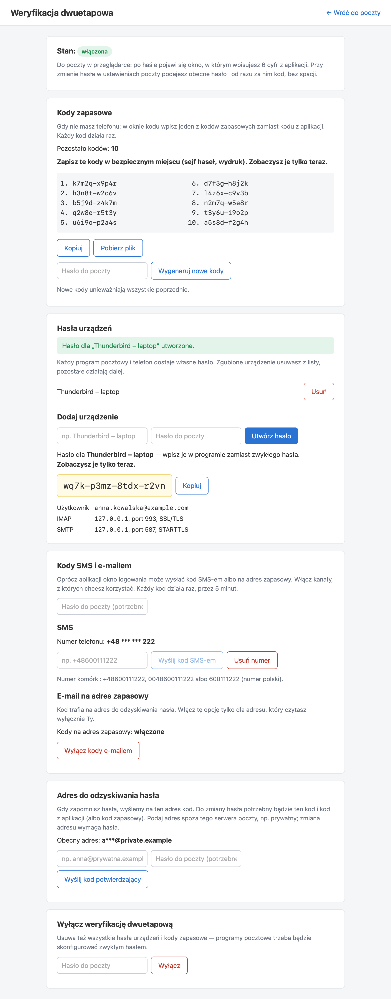 | 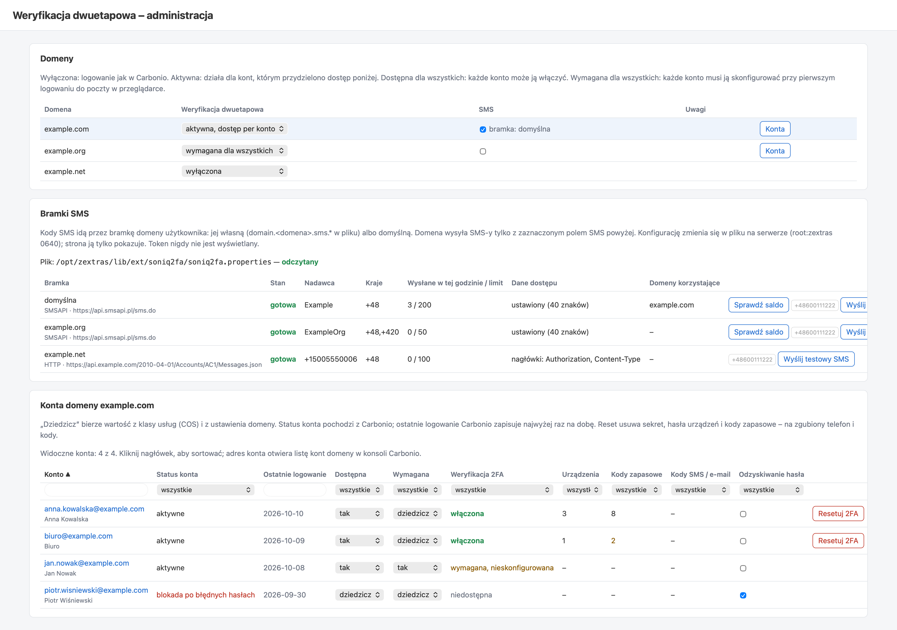 |

### Administracja


- **Najpierw kilka osób:** domena na *aktywna, dostęp per konto*, w *Konta* ustaw *Dostępna: tak* wybranym
  osobom. Pozostali niczego nie widzą.
- **Dla wszystkich:** domena na *dostępna dla wszystkich*.
- **Wymuszenie:** *Wymagana: tak* dla konta albo *wymagana dla wszystkich* dla domeny. Przy następnym logowaniu do
  poczty w przeglądarce użytkownik dostaje okno konfiguracji. Przez okres przejściowy (domyślnie 7 dni,
  `required.graceDays` w `soniq2fa.properties`) samo hasło działa wszędzie, także w programach pocztowych. Potem serwer
  je odrzuca, a strona logowania kieruje do konfiguracji 2FA.
- **Sekrety TOTP** są w LDAP zaszyfrowane kluczem `/opt/zextras/lib/ext/soniq2fa/totp.key`. Klucz trzeba mieć
  w kopii zapasowej serwera: bez niego konta z 2FA się nie zalogują.
- **Zgubiony telefon i kody zapasowe:** *Resetuj 2FA*, użytkownik konfiguruje je od nowa.
- **Zapomniane hasło:** użytkownik z potwierdzonym adresem do odzyskiwania zmienia je sam (kod z maila i kod z
  aplikacji); pozostałym nowe hasło w konsoli admina albo `carbonio prov sp`; 2FA zostaje.
- **Kody SMS:** bramka SMSAPI albo dowolna bramka HTTP (`sms.provider=http`, przykłady Twilio i Vonage w sekcji
  *Other SMS gateways*) w `/opt/zextras/lib/ext/soniq2fa/soniq2fa.properties` (root:zextras 0640), opis w
  sekcji *Codes by SMS and e-mail*. SMS włącza się **per domena** (pole *SMS* w tabeli domen); domena może mieć własną
  bramkę (`domain.<domena>.sms.*`), pozostałe korzystają z domyślnej. Sekcja *Bramki SMS* pokazuje stan, saldo i wysyła
  testowy SMS. Kody na adres zapasowy działają bez konfiguracji; kanały włącza użytkownik.
- **Odzyskiwanie hasła mailem** jest wyłączane przy włączeniu 2FA. Ponowne włączenie dla konta z 2FA wymaga
  potwierdzenia, bo kod z maila loguje bez drugiego składnika; użytkownik widzi wtedy ostrzeżenie.

### Instrukcja dla użytkownika

Do przekazania użytkownikom, którym 2FA jest dostępne. Przykłady dotyczą fikcyjnej użytkowniczki
`anna.kowalska@example.com` na `mail.example.com`; wstaw własne dane.

**1. Aplikacja w telefonie.** Google Authenticator, Microsoft Authenticator, Authy, 1Password albo Bitwarden.

**2. Strona weryfikacji.** Zaloguj się do poczty w przeglądarce i otwórz **Ustawienia → Weryfikacja dwuetapowa**
(albo `https://mail.example.com/service/extension/soniq2fa`). Strona wyjaśnia, co się zmieni, i że włączenie
wyłącza odzyskiwanie hasła mailem, które pozwalałoby ominąć drugi składnik.

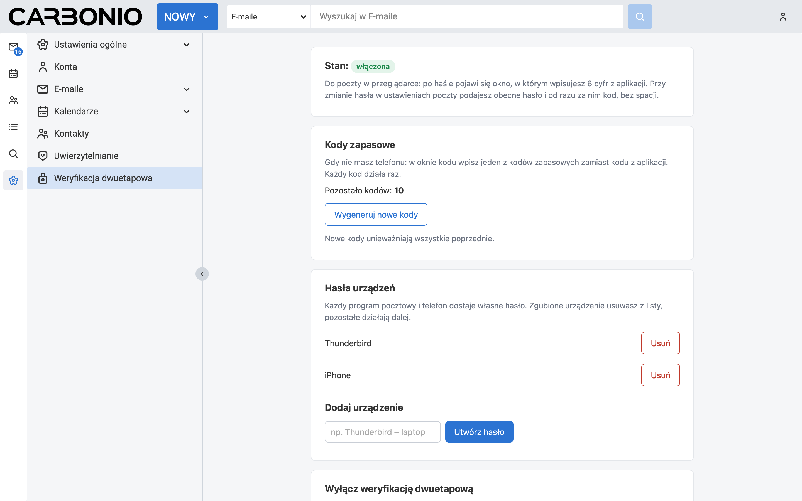

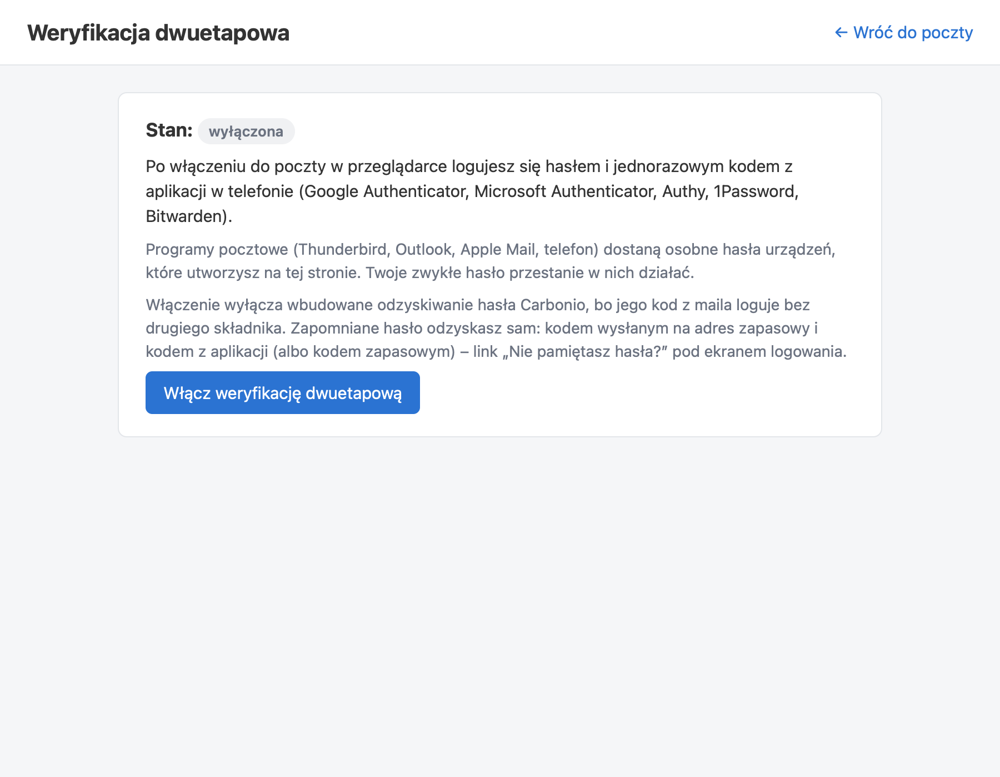

**3. Kod QR i potwierdzenie.** Kliknij **Włącz weryfikację dwuetapową**, zeskanuj kod QR aplikacją (albo wpisz
klucz obok), potem hasło do poczty i 6 cyfr z aplikacji, i kliknij **Potwierdź i włącz**. Źle zeskanowany kod
niczego nie zmienia: 2FA działa dopiero po pierwszym poprawnym kodzie.

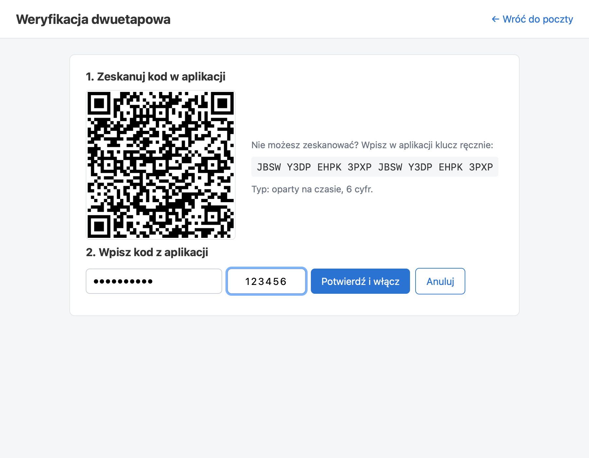

**4. Kody zapasowe.** Strona pokazuje jednorazowo 10 kodów. Pobierz albo skopiuj je i przechowuj poza telefonem
(sejf haseł, wydruk). Zastępują telefon, gdy go nie masz. **Wygeneruj nowe kody** prosi o hasło do poczty
i unieważnia poprzednie.

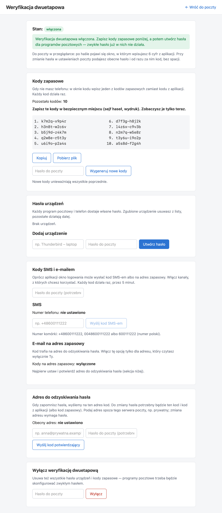

**5. Hasła urządzeń.** Od teraz Thunderbird, Outlook, Apple Mail, poczta, kalendarz i kontakty w telefonie oraz
konta kalendarza i kontaktów w macOS potrzebują hasła urządzenia. W **Hasła urządzeń** wpisz nazwę (np.
*Thunderbird – laptop*) i hasło do poczty, kliknij **Utwórz hasło** i wpisz je w programie zamiast zwykłego hasła. Widać je tylko
raz; zgubione urządzenie usuwasz z listy, pozostałe działają dalej.


**6. Adres do odzyskiwania hasła.** W **Adres do odzyskiwania hasła** wpisz adres poza tą skrzynką (prywatny),
kliknij **Wyślij kod potwierdzający** i wpisz kod z tego maila. Gdy zapomnisz hasła, kod do zmiany przyjdzie tam.

**7. Kody SMS i e-mailem (opcjonalnie).** W sekcji **Kody SMS i e-mailem** wpisz hasło do poczty i numer komórki
(`+48600111222`, `0048600111222` albo `600111222`), kliknij
**Wyślij kod SMS-em** i potwierdź numer kodem z wiadomości. Przy potwierdzonym adresie do odzyskiwania spoza tego
serwera poczty możesz też wpisać hasło i kliknąć **Wysyłaj kody na adres zapasowy**. Okno logowania zaproponuje wtedy
**Wyślij kod SMS-em** / **Wyślij kod e-mailem**. Każdy kod działa raz, przez 5 minut. Opcję e-mailową włącz tylko dla adresu, który czytasz wyłącznie Ty.

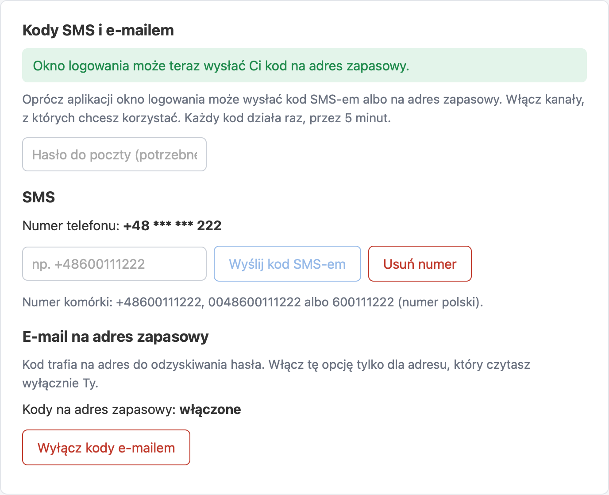

**8. Logowanie do poczty w przeglądarce.** Adres i hasło jak dotąd, potem okno na 6 cyfr z aplikacji albo kod
zapasowy. W przeglądarce, w której jeszcze nie logowałeś się z kodem, okno pojawia się, gdy serwer przyjmie hasło;
przy złym haśle jest zwykły komunikat, przy złym kodzie okno pyta ponownie:

| Znana przeglądarka | Nowa przeglądarka, po samym haśle |
|---|---|
|  | 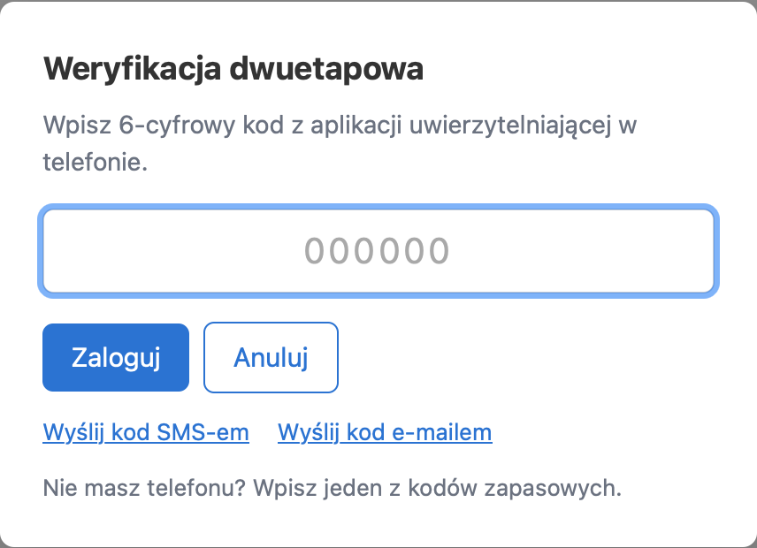 |

**Gdy 2FA jest wymagane.** Przy następnym logowaniu strona otwiera się nad pocztą. Skonfiguruj ją jak w krokach
3–5; **Przejdź do poczty** odblokowuje się po włączeniu 2FA. Konto z wymuszeniem nie wyłączy 2FA; po zmianie
telefonu użyj **Skonfiguruj od nowa**: zmienia wpis w aplikacji i kody zapasowe, hasła urządzeń zostają.

| Pierwsze logowanie | Ustawienia konta z wymuszeniem |
|---|---|
| 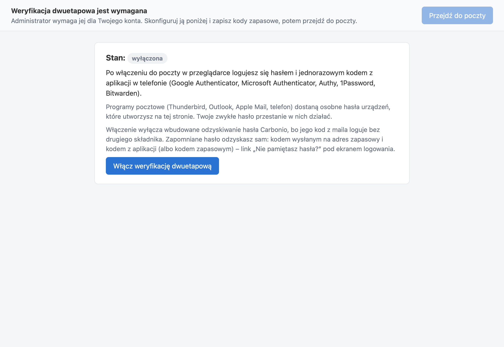 | 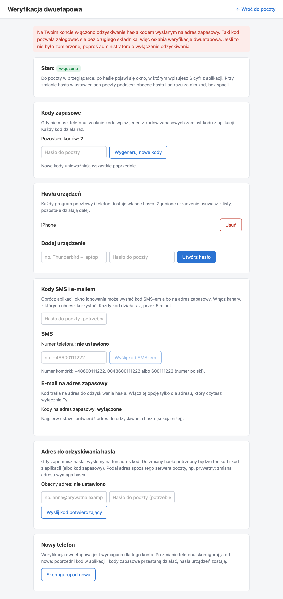 |

Czerwona uwaga u góry oznacza, że na koncie włączono odzyskiwanie hasła mailem: osłabia ono 2FA. Jeśli to nie było
zamierzone, poproś administratora o wyłączenie.

**Typowe problemy**

- Komunikat *Auth credentials have expired* na ekranie logowania: odśwież stronę i zaloguj się ponownie.
- Program pocztowy wciąż pyta o hasło: potrzebuje hasła urządzenia; zwykłe hasło do poczty jest tu odrzucane.
- Zgubiony telefon: zaloguj się kodem zapasowym, wyłącz 2FA i włącz je z nowym telefonem (przy wymuszeniu:
  *Skonfiguruj od nowa*). Hasła zgubionych urządzeń usuń z listy. Zgubiony telefon i kody zapasowe: administrator
  zeruje 2FA.
- Zapomniane hasło: **Nie pamiętasz hasła?** pod ekranem logowania
  (`https://mail.example.com/service/extension/soniq2fa-recover`). Podaj adres skrzynki, kod przyjdzie na adres do
  odzyskiwania; potem wpisz ten kod, kod z aplikacji (albo kod zapasowy) i nowe hasło. Bez adresu do odzyskiwania
  nowe hasło ustawia administrator; 2FA zostaje.
- Zmiana hasła w ustawieniach poczty: obecne hasło i od razu za nim kod z aplikacji, bez spacji.

| Krok 1 | Krok 2 |
|---|---|
| 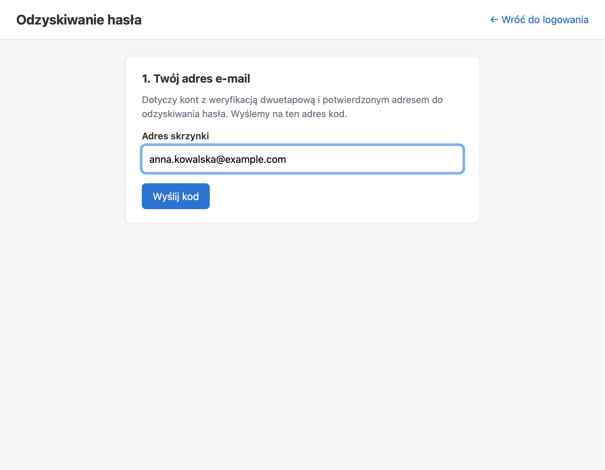 | 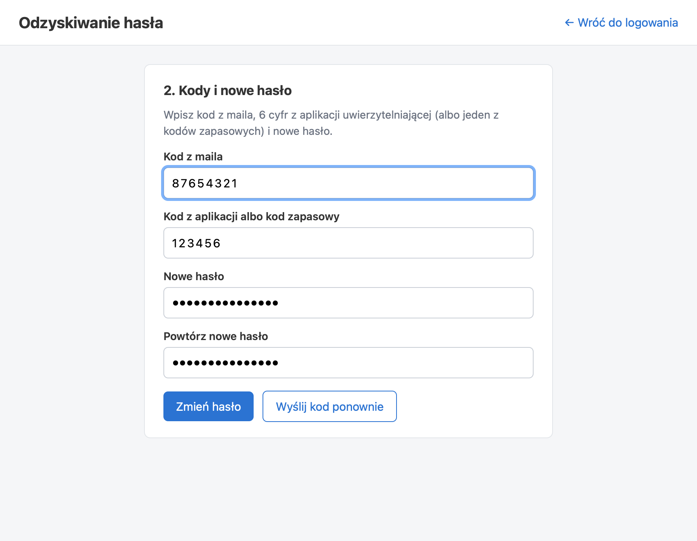 |
